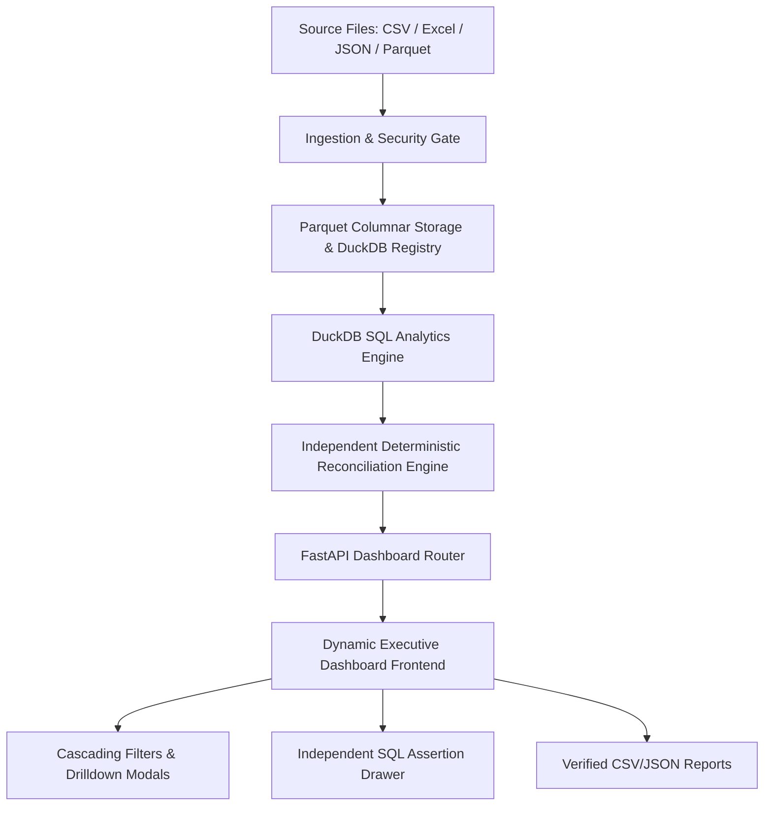
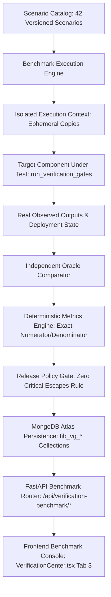

# Architecture: Real-Time Dynamic Executive Performance Management Dashboard

## 1. System Overview

The **MK-Path Executive Performance Management Dashboard** is a high-performance, Power BI-inspired analytics application engineered on top of **DuckDB** and **FastAPI**, with a reactive **React 19 / TypeScript** frontend.

The core principle of this architecture is: **DATA MUST BE VERIFIED BEFORE IT IS DISPLAYED.**
Every metric, sparkline trend, ranking, combo bar-line series, and radial donut gauge is mathematically computed server-side directly over Parquet data storage using zero-mock, deterministic DuckDB SQL aggregations.



---

## 2. Component Architecture

### A. Storage & Ingestion Tier
- **Local Parquet Fact Storage:** Data files uploaded via `/api/datasets/upload` are validated, sanitized, and stored as standardized Apache Parquet files in `datasets/parquet/<dataset_id>.parquet`.
- **DuckDB View Registry (`app.ingestion.registry`):** Dynamically registers dataset views as `"ds_<dataset_id>"` on an in-memory DuckDB connection, allowing instant sub-millisecond SQL queries over 2,500+ records.

### B. Power BI Analytics Engine (`app.analytics.engine`)
- **Schema Introspection:**
  - Automated role detection identifying temporal/date columns, primary categorical dimensions (e.g. `road_type`, `department`, `team`), secondary attributes (e.g. `city`, `location`), numeric measures, and binary target outcomes (`accident_occurred = 'Yes'`).
  - Strict exclusion of identifier keys (`*_id`, `id`) from category groupings.
- **Time Intelligence & Hierarchies:**
  - Automatic string date parsing (`strptime(incident_date, '%d-%m-%Y')` and ISO format support).
  - Multi-level time rollups: Year, Quarter, Month, and QTD (Quarter-to-Date).
  - Quarter-over-Quarter (QoQ) and Year-over-Year (YoY) trajectory deltas with percentage change calculations.
- **Dynamic Cascading Filter Context:**
  - Parameterized WHERE clause compilation preventing SQL injection.
  - Multi-dimensional filtering by Year, Quarter, Team/Category, Location, and text search.
- **Zero-Denominator & Safety Gate:**
  - Safe divisions guarded with explicit checks; returns `"N/A"` or unavailable status when denominators or prior periods are absent.

### C. Independent Reconciliation Engine (`app.analytics.reconciliation`)
- Standalone, un-nested SQL assertions executed directly against raw DuckDB tables.
- Compares:
  1. Total Record Count (`SELECT count(*)`)
  2. Filtered Record Count Context (`SELECT count(*) WHERE {filters}`)
  3. Dimension Group Sum Integrity (`SELECT sum(group_counts)`)
  4. Gauge Rate Numerators and Denominators
  5. Location Benchmark Counts
- Evaluates against a **0.0 tolerance** (exact match requirement).
- If any check deviates, the engine sets `reconciliation_passed = False` and logs a verification failure.

### D. API Tier (`app.routers.dashboard`)
- `POST /api/dashboard/analytics`: Computes complete typed payload (`DashboardAnalyticsPayload`).
- `GET /api/dashboard/filters`: Returns distinct years, quarters, teams, and locations for filter selectors.
- `POST /api/dashboard/drilldown`: Returns paginated raw underlying records for any drilled card or bar.
- `POST /api/dashboard/verify`: Executes the 5 independent SQL assertions and returns exact match telemetry.
- `POST /api/dashboard/export`: Generates executive reports in CSV or JSON format reconciling with dashboard figures.

### E. Frontend Presentation Tier (`ExecutivePerformanceDashboard.tsx`)
- Dark Executive Theme matching visual reference `#232b3b`:
  - Dark Navy Header (`#232b3b`) with live record counter and readiness status badge (`READY`, `READY_WITH_WARNINGS`, `BLOCKED`, `STALE`).
  - Dark Navy Vertical Navigation Sidebar (`#232b3b`) supporting Dashboard, Reports, Audit, and Settings views.
  - Crisp White Cards with Slate Headers (`#475569` / `#5f7185`) and `···` contextual action menus.
  - 6 Data-Driven Cards:
    1. Card 1: All teams - quarter-to-quarter (+35% QoQ, monthly sparkline).
    2. Card 2: Leading team - year-over-year (-26% YoY, yearly sparkline).
    3. Card 3: Top and bottom 3 teams - percentage of goals (YTD, green/red progress bars).
    4. Card 4: Quarterly team performance (tabbed combo bar + line chart with interactive drilldown).
    5. Card 5: Meetings attended / Engagement rate (tabbed circular radial donut gauge).
    6. Card 6: Location performance benchmark (tabbed circular radial donut gauge).
  - Independent SQL Verification Drawer & Interactive Underlying Record Drilldown Drawer.

---

## 3. Fault-Injection Benchmark for Verification Gates (FIB-VG) Architecture

Option B implements an independent evaluation harness to stress-test MK-Path's verification gates, stability metrics, and deployment-blocking controls:



### Key Architectural Tenets:
1. **Independent Oracle Layer**: Ground truth is specified in `backend/app/benchmark/catalog.py` completely independent of the target verification code.
2. **Zero-Mock Policy**: Metrics represent exact mathematical computations over completed in-memory test executions. No fabricated percentages or dummy histories exist in production.
3. **Strict Containment**: Critical verification failures directly block downstream ML model artifact generation (`generate_deployment_artifacts`).
4. **Cloud-Native Atlas Persistence**: Runs and scenario results are committed to MongoDB Atlas (`fib_vg_runs`, `fib_vg_scenario_results`, `fib_vg_audit_events`) with write confirmation and readback integrity checks.

---

## 4. Attested Result Envelopes with Healing Lineage (Option C ARE-HL) Architecture

Option C establishes an enterprise cryptographic provenance, non-repudiation, and auditability layer spanning the entire analytical lifecycle:

```mermaid
graph TD
    Raw[Raw Ingestion File] -->|Compute Streaming SHA-256| SI[SourceIdentity]
    SI --> HE[Healing Engine]
    HE -->|Assert Parent Immutability| Derived[Isolated Parquet Derivative]
    HE -->|Capture DQM & Rules| TO[TransformationLineage]
    Derived --> AE[Analysis Engine DuckDB / ML]
    AE -->|Compute Metrics & Schema Hashes| AR[AnalyticalResultProvenance]
    AR --> VG[Verification Gates & PMSG]
    VG -->|Evaluate Quality, Leakage, Multiverse| VP[VerificationProvenance]
    AE --> MLE[ML Engineer Artifact Generator]
    MLE -->|Streaming SHA-256 Manifest| AP[ArtifactProvenance]
    SI & TO & AR & VP & AP --> ARE[AttestedResultEnvelope Model]
    ARE -->|RFC 8785 JCS Canonicalization| Canon[Canonical Payload Bytes]
    Canon -->|Sign with Active Ed25519/RSA Key| Signer[Cryptographic Signer]
    Signer -->|Digital Attestation Metadata| Sealed[Sealed ARE-HL Envelope]
    Sealed --> Atlas[(MongoDB Atlas: attestation_envelopes)]
    
    subgraph Lineage Tracking
        Ev1[DATASET_INGESTION] -->|SHA256(e2 || h1)| Ev2[HEALING_EXECUTION]
        Ev2 -->|SHA256(e3 || h2)| Ev3[ANALYSIS_EXECUTION]
        Ev3 -->|SHA256(e4 || h3)| Ev4[VERIFICATION_GATE_EVALUATION]
        Ev4 --> Checkpoint[Signed Chain Checkpoint]
    end
```

### Architectural Subsystems:
1. **Cryptographic Core (`backend/app/attestation/crypto.py`)**:
   - Manages Ed25519 and RSA-PSS keypairs.
   - Maintains an in-memory keystore and a public key trust registry with support for ACTIVE, RETIRED, and REVOKED states.
   - Enforces fail-closed verification.
2. **Canonicalization & Streaming Hashing (`backend/app/attestation/hashing.py`)**:
   - IETF RFC 8785 JSON Canonicalization Scheme (JCS) serializer with deterministic key sorting, whitespace stripping, and float normalization.
   - Chunked (64 KB) streaming SHA-256 for physical files and memory buffers.
3. **Tamper-Evident Lineage Graph (`backend/app/attestation/lineage.py`)**:
   - Sequential event chaining linking inputs, outputs, rules, and actors via `SHA256(canonical(event) || prev_hash)`.
   - Continuous chain traversal verification with broken-link and cycle detection.
   - Signed chain-head checkpoints.
4. **Attestation Service (`backend/app/attestation/service.py`)**:
   - Central coordinator constructing strongly typed envelopes.
   - Blocks signing and deployment if critical verification gates fail.
   - Persists to MongoDB Atlas (`attestation_envelopes`, `lineage_events`, `lineage_checkpoints`).
5. **Artifact Deployment Guard (`backend/app/engineering/ml_engineer.py`)**:
   - Generates streaming SHA-256 manifests in `metadata.json`.
   - `verify_artifact_deployment_readiness` blocks any download or deployment if artifact bytes on disk diverge from attested hashes.

