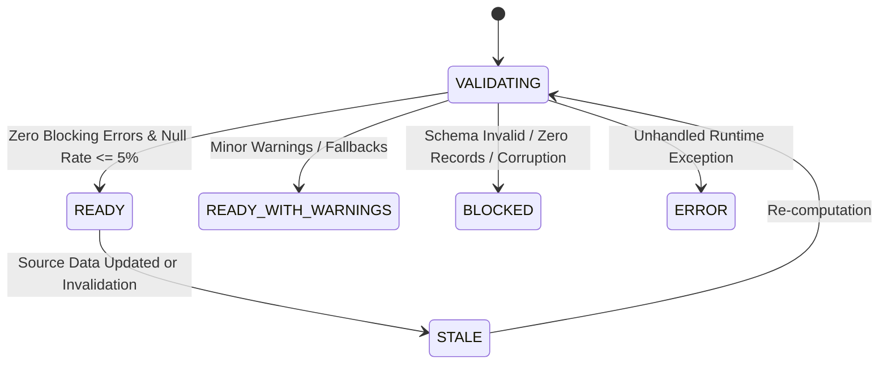

# Data Validation & Readiness Quality Gates

This document defines the data verification protocols, readiness lifecycle, and deterministic validation rules enforcing the core requirement: **DATA MUST BE VERIFIED BEFORE IT IS DISPLAYED.**

---

## 1. Readiness State Lifecycle

Every dataset and derived analytical payload is evaluated against an explicit readiness state machine:



### Readiness Status Definitions

1. **`VALIDATING`**
   - Ingestion or analytics computation is actively in progress inside DuckDB.
   - Frontend displays a progress skeleton and disables interactive actions.

2. **`READY`**
   - Dataset exists and is fully accessible in Parquet storage.
   - All required columns exist and match expected types.
   - Null value rate is within acceptable tolerances (< 5%).
   - Metrics compute deterministically without fallback approximations.
   - Independent SQL reconciliation passes with zero tolerance.

3. **`READY_WITH_WARNINGS`**
   - Dataset is valid and displayable, but non-blocking boundary conditions exist (e.g., date parsing required fallback formatting, or dataset contains only one reporting year).
   - Warnings are explicitly surfaced on the dashboard and quality report.

4. **`BLOCKED`**
   - Mandatory validation failed (missing schema columns, corrupted Parquet format, or zero rows).
   - The dashboard is completely blocked from displaying metrics; an explicit error message is displayed.

5. **`STALE`**
   - Source dataset was updated, re-uploaded, or filter context invalidates earlier cache keys.
   - Dashboard flags metrics as stale until refreshed.

6. **`ERROR`**
   - System error or database connection failure. Returned with explicit HTTP 500 error and stack trace logged securely.

---

## 2. Ingestion & Quality Checks

During upload and ingestion, the following deterministic checks are executed:

1. **File Type & Format Validation:**
   - Supports CSV, TSV, JSON, NDJSON, Excel (XLSX), Parquet, SQL dump, and ZIP archives.
   - MIME type and magic byte sniffing prevents executable binaries masquerading as text.

2. **Security & Archive Protection:**
   - Path-traversal (`ZipSlip`) prevention blocks entries containing `../` or absolute drive roots.
   - Compression ratio limits (`MAX_ZIP_RATIO = 500`) and uncompressed size ceilings (`MAX_ZIP_UNCOMPRESSED_MB = 2000`) prevent decompression bombs.

3. **Schema & Nullability Checks:**
   - Detects all column headers, SQL data types, row counts, and null rates.
   - Profiles missing value percentages across every column.

---

## 3. Independent SQL Reconciliation Protocol

To ensure dashboard integrity, the application implements an independent reconciliation engine (`backend/app/analytics/reconciliation.py`).

Unlike helper function reruns, this engine issues **direct, non-nested DuckDB SQL queries** against the raw table to verify:

1. **Assertion 1 — Total Record Count:**
   ```sql
   SELECT count(*) FROM "ds_<dataset_id>";
   ```
   Must match `quality_summary.total_records` with zero tolerance (2,500 == 2,500).

2. **Assertion 2 — Filtered Context Record Count:**
   ```sql
   SELECT count(*) FROM "ds_<dataset_id>" WHERE {active_filters};
   ```
   Must match `quality_summary.filtered_records` exactly.

3. **Assertion 3 — Dimension Group Sum Integrity:**
   ```sql
   SELECT COALESCE(SUM(cat_count), 0) FROM (
       SELECT COUNT(*) as cat_count FROM "ds_<dataset_id>"
       WHERE {active_filters}
       GROUP BY road_type
   );
   ```
   The sum of distinct category counts must equal the total filtered records.

4. **Assertion 4 — Gauge Numerator & Denominator Rates:**
   ```sql
   SELECT 
       COUNT(*) as denom,
       COUNT(CASE WHEN accident_occurred = 'Yes' THEN 1 END) as num
   FROM "ds_<dataset_id>"
   WHERE {active_filters} AND road_type = 'Urban arterial';
   ```
   Must match `card5.numerator` and `card5.denominator` with zero deviation.

5. **Assertion 5 — Location Benchmark Record Counts:**
   ```sql
   SELECT 
       COUNT(*) as denom,
       COUNT(CASE WHEN accident_occurred = 'Yes' THEN 1 END) as num
   FROM "ds_<dataset_id>"
   WHERE {active_filters} AND city = 'Chennai';
   ```
   Must match `card6.numerator` and `card6.denominator` exactly.

If all assertions match with **0.0 tolerance**, the reconciliation passes and a `ReconciliationResponse` is returned to the client.
