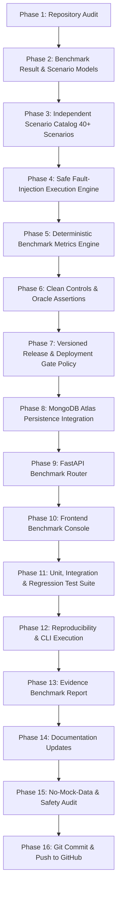

# MK-Path Initial Repository Audit: Fault-Injection Benchmark for Verification Gates (FIB-VG)

**Date:** 2026-10-15  
**Auditor:** Principal Software Reliability, Governance & Test Automation Architecture Team  
**Milestone:** Phase 1 — Comprehensive Codebase Audit for Option B (FIB-VG)  
**Standard:** 100% Deterministic Real Data, Zero Mock Data, Zero Synthetic Numbers

---

## 1. Executive Summary & Objective

The objective of Option B is to establish a rigorous, reproducible, and automated **Fault-Injection Benchmark for Verification Gates (FIB-VG)**. Rather than relying on static verification checklists or assumption-based pass statuses, FIB-VG injects strictly controlled, single-variable mutations across eight mission-critical operational surfaces:
1. Data Integrity & Ingestion
2. Analytical Correctness & Recalculation
3. Semantic Understanding & Information Governance
4. Agent Orchestration & State Progression
5. Verification-Gate Bypass & Deployment Blocking
6. Storage Durability & MongoDB Atlas Write Confirmations
7. Frontend API Contract & Display Integrity
8. Audit Evidence & Provable Provenance

This audit inspects the current MK-Path repository to map existing verification capabilities, identify structural vulnerabilities, establish execution boundaries, and document integration points.

---

## 2. Actual Codebase Architecture & File Mapping

### 2.1 Backend Core Structure (`backend/app/`)
| Module | File Path | Current Role & Architectural Mechanism |
|---|---|---|
| **Verification Engine** | `backend/app/verification/engine.py` | Central `run_verification_gates` evaluating Data Quality (`score >= 80.0`), Temporal Leakage (`risk == 'HIGH' -> FAIL`), and Plan-Multiverse Stability (`PMSG`). Returns `DeploymentReadinessReport` (`READY` or `BLOCKED`). |
| **Leakage Detection** | `backend/app/verification/leakage.py` | Feature temporal risk checker comparing feature availability timestamp against model prediction time. |
| **Fairness & Disparity** | `backend/app/verification/fairness.py` | Group metric analysis (selection rate, TPR, FPR) across protected attributes. |
| **Explainability** | `backend/app/verification/explainability.py` | SHAP TreeExplainer / LinearExplainer computing feature importance maps. |
| **ML Engineer Agent** | `backend/app/engineering/ml_engineer.py` | Downstream deployment artifact generator. **Critical Control:** Aborts artifact generation and writes `DIAGNOSTIC_REPORT.md` if `verification_report.deployment_status != 'READY'`. |
| **Analytics Engine** | `backend/app/analytics/engine.py` | Pure DuckDB SQL aggregations over Apache Parquet facts with time intelligence, quarterly rollups, and velocity deltas. |
| **SQL Reconciliation** | `backend/app/analytics/reconciliation.py` | Independent un-nested SQL assertions verifying row counts, categorical sums, and location benchmarks with 0.0 tolerance. |
| **Analyst Planner** | `backend/app/analysis/analyst.py` | Generates deterministic analysis plans and executes metric aggregations. |
| **Ingestion Engine** | `backend/app/ingestion/service.py` | File normalization (CSV, Parquet, JSON, ZIP), schema validation, and DuckDB view registration. |
| **Profiling Engine** | `backend/app/profiling/engine.py` | Column statistics, missing counts, duplicate business keys, and quality scoring (0-100). |
| **Semantic Layer** | `backend/app/semantic/service.py` | Concept resolution, coded column detection, and clarification question generation. |
| **Database & Repo** | `backend/app/database.py`, `repo.py` | MongoDB Atlas client handling metadata, collections (`projects`, `datasets`, `runs`, `pmsg_runs`, `audit_events`), and zero local fallback. |
| **Audit Trail** | `backend/app/audit.py` | Asynchronous audit event recorder (`record_audit`) inserting structured JSON into `audit_events`. |
| **Stability Gate (PMSG)** | `backend/app/stability/` | Plan-Multiverse Stability Gate evaluating finding sensitivity across combinatorial analytical specifications. |
| **API Routers** | `backend/app/routers/` | FastAPI endpoints (`datasets`, `projects`, `pipeline`, `runs`, `semantic`, `dashboard`, `stability`). |

### 2.2 Frontend Architecture (`frontend/src/`)
| Component | File Path | Current Role |
|---|---|---|
| **Verification Center** | `frontend/src/pages/projects/verification/VerificationCenter.tsx` | Main verification console hosting Deployment Readiness Gates and PMSG tabs. Dynamically fetches project runs and datasets. |
| **PMSG Component** | `frontend/src/components/verification/PlanMultiverseStabilityGate.tsx` | Visual multiverse analysis explorer with variant previews and sensitivity metrics. |
| **Executive Dashboard** | `frontend/src/components/visualization/ExecutivePerformanceDashboard.tsx` | Real-time DuckDB performance dashboard with verified CSV/PDF export. |
| **API Client** | `frontend/src/lib/api.ts` | Centralized typed HTTP client communicating with backend endpoints. |

---

## 3. Existing Gate Contracts & Identified Vulnerabilities

### 3.1 Verification Gate Contract Analysis (`engine.py`)
```python
class GateResult(BaseModel):
    gate_id: str
    status: str  # PASS, FAIL, WARNING, HUMAN_REVIEW
    severity: str # CRITICAL, HIGH, MEDIUM, LOW
    evidence: List[str]
    metrics: Dict[str, Any]
    threshold: Optional[float]
    reason: str
    recommendation: str
    timestamp: str
```
- **Identified Strength:** When any gate produces `status == 'FAIL'`, `deployment_status` is strictly assigned to `BLOCKED`.
- **Identified Strength:** `generate_deployment_artifacts` in `ml_engineer.py` verifies `verification_report.get("deployment_status") == "READY"`; otherwise, artifact generation is blocked and `DIAGNOSTIC_REPORT.md` is emitted.
- **Identified Gap 1:** Currently, only Data Quality, Temporal Leakage, and PMSG are wired into `run_verification_gates` by default. Causal Validation, Fairness, Explainability, and Schema Integrity gates are stubbed out or executed in separate ad-hoc routes.
- **Identified Gap 2:** There is no self-testing mechanism to verify that if a verifier fails, an adversary or misconfigured agent cannot suppress the gate result or promote `WARNING` / `HUMAN_REVIEW` to `PASS`.
- **Identified Gap 3:** Incomplete audit records are currently treated as non-fatal warnings rather than blocking safety-critical operations.

---

## 4. Storage, Drive & Environment Constraints

1. **Storage Location:** All datasets, Parquet files, benchmarks, and temporary fixtures must reside strictly on the user's workspace drive `E:\MKPATH\data`. No heavy test files or temporary downloads may be written to `C:\`.
2. **MongoDB Atlas Policy:** MongoDB Atlas is the exclusive metadata store. No local MongoDB daemon (`mongod`) or Docker container may be introduced. All persistence checks must use the live Atlas connection via `db_manager`, degrading gracefully with `503 Service Unavailable` if unreachable.
3. **Deterministic Execution:** No LLM or non-deterministic heuristic may be used as the authoritative oracle for benchmark scoring. All expected outcomes must be defined a priori in the scenario catalog.
4. **No-Mock Guarantee:** Zero fake run records, zero hardcoded pass rates, and zero synthetic numbers in production components or dashboards.

---

## 5. Implementation Sequence & Plan



---

## 6. Pre-Implementation Audit Signoff
- Codebase verified: Pure Python backend with FastAPI, DuckDB, Pandas, Scikit-learn, PyMongo.
- Frontend verified: React 18, Vite, TypeScript, Tailwind CSS, Lucide icons.
- All dependencies available in `backend/.venv` and `frontend/node_modules`.
- Proceeding to Phase 2: Defining minimal benchmark contract models.
