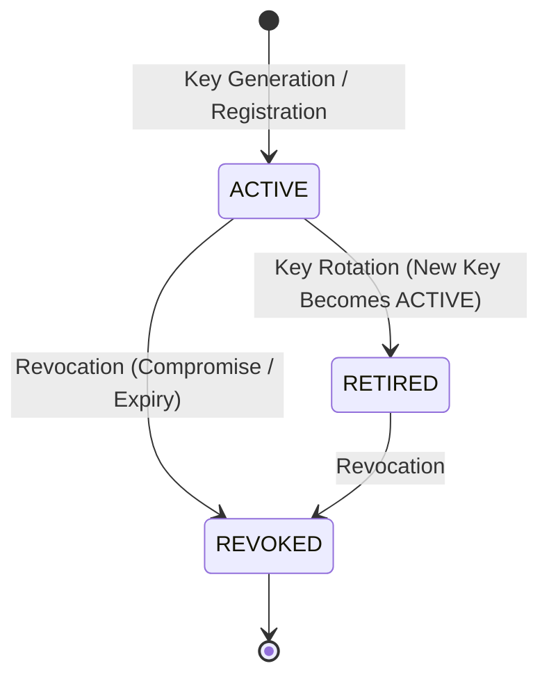

# MK-PATH Option C — Cryptographic Key Management & Trust Architecture

## 1. Key Storage Architecture & Isolation

In accordance with strict enterprise security practices:
> **Private signing keys are NEVER committed to Git, hardcoded in source code, or stored in plaintext database collections.**

Private key material is isolated within the in-memory runtime of `KeyManager` (`backend/app/attestation/crypto.py`).

### Key Sourcing Priority:
1. **Production Deployment**: Loaded from environment variable `MKPATH_SIGNING_PRIVATE_KEY` (base64-encoded PKCS#8 or raw 32-byte Ed25519 seed) accompanied by `MKPATH_SIGNING_KEY_ID` and `MKPATH_SIGNING_KEY_VERSION`.
2. **Local Development / Isolated Test**: If `MKPATH_DEV_SIGNING=true` (the default in non-production environments), an isolated in-memory ephemeral Ed25519 keypair is dynamically generated upon server startup and registered as active key `mkpath-dev-key-01`.

---

## 2. Public Key Registry & Verification Trust Store

The `KeyManager` maintains an internal public verification registry containing `KeyRecord` instances:

```json
{
  "key_id": "mkpath-root-v1",
  "key_version": "1.0.0",
  "algorithm": "Ed25519",
  "public_key_pem": "-----BEGIN PUBLIC KEY-----\nMCowBQYDK2VwAyEA...\n-----END PUBLIC KEY-----\n",
  "state": "ACTIVE",
  "trusted": true,
  "created_at": "2026-10-16T15:00:00Z",
  "revoked_at": null,
  "revocation_reason": null
}
```

The public keys are exposed to authorized consumers via the REST API endpoint:
`GET /api/attestations/keys/public`.

---

## 3. Key Lifecycle Management



### Key States:
- **ACTIVE**: Authorized for signing new Attested Result Envelopes and verifying existing ones.
- **RETIRED**: Superseded by a newer key; rejected for new signings, but valid for verifying past attestations signed during its active lifecycle.
- **REVOKED**: Compromised or invalid; immediately rejected for both signing and verification. Any envelope referencing a revoked key returns `overall_status: "REVOKED_KEY"`.

### Administrative Revocation:
An authorized administrator can revoke a compromised key via:
`POST /api/attestations/keys/revoke` with `{ "key_id": "...", "reason": "Suspected compromise" }`.
